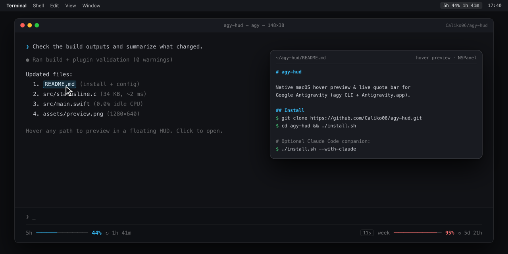

<p align="center">
  
</p>

<h1 align="center">agy-hud</h1>

<p align="center">
  <strong>Native macOS hover file previews & live quota bar for Google Antigravity (<code>agy</code> CLI + <code>Antigravity.app</code>)</strong><br />
  <sub>Pure C statusLine (~3 ms) · Event-driven Swift HUD (0.0% idle CPU) · Optional Claude Code companion included</sub>
</p>

<p align="center">
  
  
  
  
</p>

---

When coding with **Google Antigravity** (`agy` CLI or `Antigravity.app`), agents constantly reference screenshots, logs, and Markdown files you cannot preview without opening them one by one, and checking your 5-hour or weekly quota means interrupting your flow with `/usage`.

**`agy-hud`** fixes both natively on macOS with zero Node/Python runtime overhead:

### What you get

| Feature | How it works | Footprint |
| --- | --- | --- |
| **Hover File & Image Preview** | Hover any file path (`.png`, `.jpg`, `.webp`, `.heic`, `.md`, `.txt`, `.json`, `.log`, source code) in your terminal or `Antigravity.app` to pop open a borderless macOS HUD panel without stealing focus. Click in terminal to open it in the default viewer. | **0.0% idle CPU** (event-driven Swift, reusable `NSPanel`, `ImageIO` Retina thumbnails, 8 KB text read cap) |
| **Live Quota Bar (`statusLine` + Menu Bar)** | Alternates every **11 seconds** between your **5-hour** (`2h 10m`) and **weekly** (`5d 21h`) windows with color thresholds (`<75%` cyan, `>=75%` yellow, `>=90%` red). | **34 KB C binary**, `~2–3 ms` execution, zero interpreter startup |
| **Multi-Terminal Support** | Works out of the box in `Terminal.app`, `iTerm2`, `Ghostty`, `Warp`, `WezTerm`, `Kitty`, and `Antigravity.app`. | Supervised natively as an AGY plugin sidecar |
| **Claude Code Companion (Bonus)** | Optional `path-preview` UI mod for Claude Code in [`claude-code/`](./claude-code/) if you use both agents. | Opt-in via `--with-claude` |

```text
5h    ━━━━──────  43% ↻ 2h 10m
week  ━━━━━━━━━─  95% ↻ 5d 21h
```

## Quick Install

Requires macOS (Apple Silicon or Intel) with Xcode Command Line Tools (`clang`, `swiftc`) and Google Antigravity (`agy`).

```bash
git clone https://github.com/Caliko06/agy-hud.git
cd agy-hud
./install.sh
```

Want the optional **Claude Code** `path-preview` companion mod too?

```bash
./install.sh --with-claude
```

### One-time macOS permission (for Hover Preview)

Enable **Antigravity** once in **System Settings → Privacy & Security → Accessibility** so the sidecar can read the file path under your cursor. If it isn't enabled yet, the menu bar item shows a 1-click shortcut directly to that pane.

*(The quota bar works with zero permissions.)*

## Configuration

- **Keep AGY's default status line alongside the quota bar:** set `"stack_with_default": true` under `"statusLine"` in `~/.gemini/antigravity-cli/settings.json`.
- **Change rotation interval:** adjust `ROTATE_SEC` in [`src/statusline.c`](./src/statusline.c) and `withTimeInterval: 11.0` in [`src/main.swift`](./src/main.swift), then re-run `./install.sh`.

## Uninstall

```bash
~/.gemini/config/plugins/agy-hud/uninstall.sh
# or include the Claude Code companion:
~/.gemini/config/plugins/agy-hud/uninstall.sh --with-claude
```

## Credits & License

- Built by [Angel Miranda](https://github.com/Caliko06).
- The visual style of the quota bar and the optional Claude Code companion mod (`claude-code/`) are inspired by and adapted from [`midudev/better-claude`](https://github.com/midudev/better-claude) (MIT).
- Released under the [MIT License](./LICENSE).
